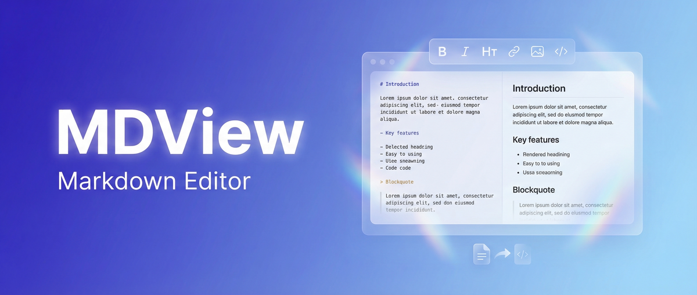

<div align="center">

# MDView

> **Korean-first markdown editor** — HWP/HWPX to Markdown, Markdown to HWPX

[](https://github.com/revfactory/mdview/actions/workflows/ci.yml)
[](https://github.com/revfactory/mdview/actions/workflows/codeql.yml)
[](LICENSE)
[](https://nextjs.org)
[](https://react.dev)
[](https://www.typescriptlang.org)

[한국어](README.md) | **English**

<br />



</div>

## 🖼 Use MDView online

[Open the MDView editor](https://mdview.kr/) without installation or an account. Import HWP/HWPX files, then export Markdown or HWPX.

The interface and these task guides are in Korean:

- [Convert HWP/HWPX to Markdown](https://mdview.kr/guides/hwp-to-markdown)
- [Export Markdown as HWPX](https://mdview.kr/guides/markdown-to-hwpx)
- [Save Markdown as PDF](https://mdview.kr/guides/markdown-to-pdf)
- [Editor and local storage guide](https://mdview.kr/guides/markdown-editor)

Documents are stored in the current browser. Export important files as backups and check complex tables, images, and formatting after conversion. Export to the binary `.hwp` format is not supported.

If saved documents are missing, check both [mdview.kr](https://mdview.kr/) and [www.mdview.kr](https://www.mdview.kr/) on the device and browser profile used to create them. The two addresses have separate storage and do not sync documents automatically. Do not clear site data while checking, and export important documents once you find them. See the [document storage and backup guide (Korean)](https://mdview.kr/guides/markdown-editor#document-storage).

## 📖 Overview

**MDView** is a block-based WYSIWYG markdown editor that lets you write documents naturally — like a word processor — without knowing any markdown syntax. Internally, everything is stored as plain markdown (`.md`), so your content stays portable across any platform.

Three core differentiators:

1. **🇰🇷 HWP Bridge** — Import HWP/HWPX (Korean Hangul Word Processor) files into markdown, and export markdown back to HWPX.
2. **⚡ Large Document Performance** — Web Worker parsing and pagination process long documents in chunks. Processing time and formatting fidelity depend on the file and device.
3. **🧱 Block-Based Editing** — Notion-style slash commands and drag-and-drop block reordering.

> ⚠️ Currently in 0.x pre-release. Minor version bumps may include breaking changes until 1.0.

## ✨ Features

- **Block-based WYSIWYG editing** — Headings, lists, code, blockquotes, checklists, tables, images
- **Slash (/) commands** — Instant block type conversion and insertion
- **Drag-and-drop** — Reorder blocks visually
- **HWP/HWPX import, HWPX export** — Convert Korean Hangul Word documents to Markdown and export `.hwpx` files
- **Markdown file I/O** — Open and save `.md` directly
- **PDF export** — Browser print/Save as PDF for non-chunked WYSIWYG documents
- **Source / Split view** — Toggle between WYSIWYG and raw markdown
- **Large document pagination** — Auto chunking for documents over 300KB
- **Full-text search** — FlexSearch in a Web Worker
- **Autosave** — IndexedDB (via Dexie.js) local storage
- **Dark / Light theme** — Follows system preference
- **Math rendering** — KaTeX
- **Code syntax highlighting** — Shiki
- **Auto-generated TOC**
- **Web app manifest** — Offline reload is not guaranteed.
- **Responsive design** — Desktop, tablet, mobile

## 🚀 Quick Start

### Prerequisites

- Node.js 20 LTS or newer
- npm (or pnpm/yarn)

### Install & Run

```bash
git clone https://github.com/revfactory/mdview.git
cd mdview
npm install
npm run dev
```

Open [http://localhost:3000](http://localhost:3000) in your browser.

### Production Build

```bash
npm run build
npm run start
```

## 🛠 Tech Stack

| Area | Stack |
|------|-------|
| **Framework** | Next.js 16 + React 19 |
| **Language** | TypeScript 6 (strict) |
| **Editor Core** | TipTap 3 (ProseMirror-based) |
| **Styling** | Tailwind CSS 4 |
| **Local DB** | Dexie.js 4 (IndexedDB) |
| **State** | Zustand 5 + dexie-react-hooks |
| **Search** | FlexSearch (Web Worker) |
| **HWP Parser** | Custom parser + cfb |
| **Math** | KaTeX |
| **Code Highlight** | Shiki |

## 📐 Project Structure

```
src/
├── app/            # Next.js App Router (pages, routing)
├── components/     # UI components (features/, ui/, layout/)
├── db/             # Dexie schema and CRUD
├── extensions/     # TipTap custom extensions
├── hooks/          # Shared React hooks
├── lib/            # Markdown / HWP conversion utilities
├── stores/         # Zustand stores
├── styles/         # Global / theme styles
├── types/          # Shared TypeScript types
└── workers/        # HWP parser, search indexer Workers
```

## 🗺 Roadmap

### v0.x (Current)
- [x] Block-based WYSIWYG editor
- [x] HWP/HWPX import & export
- [x] Large document pagination
- [x] PDF export
- [x] Web app manifest

### v1.0 (Planned)
- [ ] DOCX import & export
- [ ] Cloud sync (Supabase)
- [ ] Real-time multi-user collaboration (Yjs)
- [ ] Version history & restore

### Beyond
- [ ] AI writing assistant
- [ ] Plugin system
- [ ] Presentation mode (Marp-based)

See `<future_considerations>` in [`MDVIEW_SPEC.md`](MDVIEW_SPEC.md) for the initial ideas. That design document includes unimplemented features and performance targets. Use this README and the [usage guides](https://mdview.kr/guides) for currently supported behavior.

## 🤝 Contributing

Contributions are welcome. Before getting started, please read:

- [Contributing Guide](CONTRIBUTING.md)
- [Code of Conduct](CODE_OF_CONDUCT.md)
- [Changelog](CHANGELOG.md)

## 🔒 Security

Please do **not** report security vulnerabilities through public GitHub issues. See [`SECURITY.md`](SECURITY.md) for our responsible disclosure process.

## 📜 License

This project is licensed under the [Apache License 2.0](LICENSE).

```
Copyright 2026 revfactory and MDView contributors

Licensed under the Apache License, Version 2.0 (the "License");
you may not use this file except in compliance with the License.
```

## 🙏 Acknowledgments

MDView stands on the shoulders of giants:

- [TipTap](https://tiptap.dev) — Headless editor framework
- [ProseMirror](https://prosemirror.net) — Editor core
- [Next.js](https://nextjs.org) — React framework
- [Dexie.js](https://dexie.org) — IndexedDB wrapper
- [FlexSearch](https://github.com/nextapps-de/flexsearch) — Full-text search engine
- [KaTeX](https://katex.org) — Math typesetting
- [Shiki](https://shiki.style) — Syntax highlighting

And many thanks to everyone who has filed feedback in our [Issues](https://github.com/revfactory/mdview/issues).
